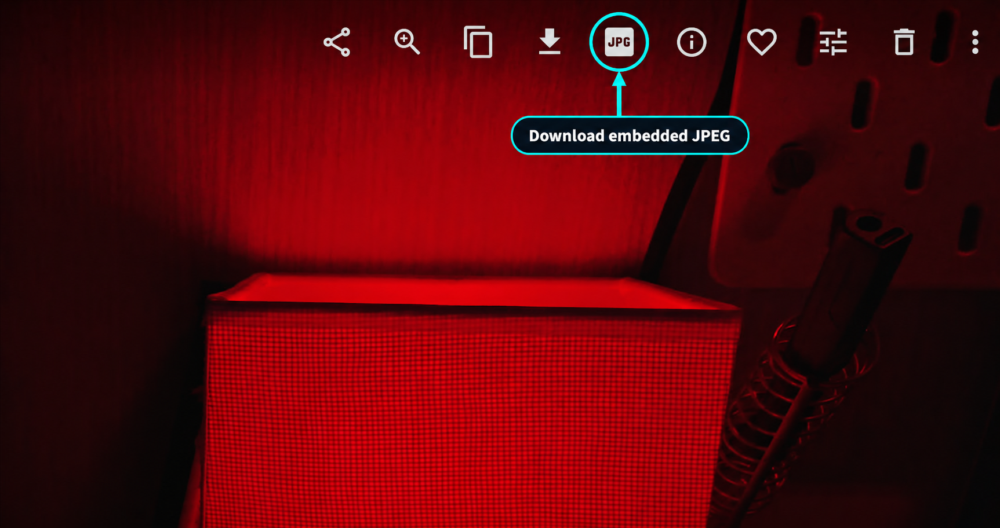
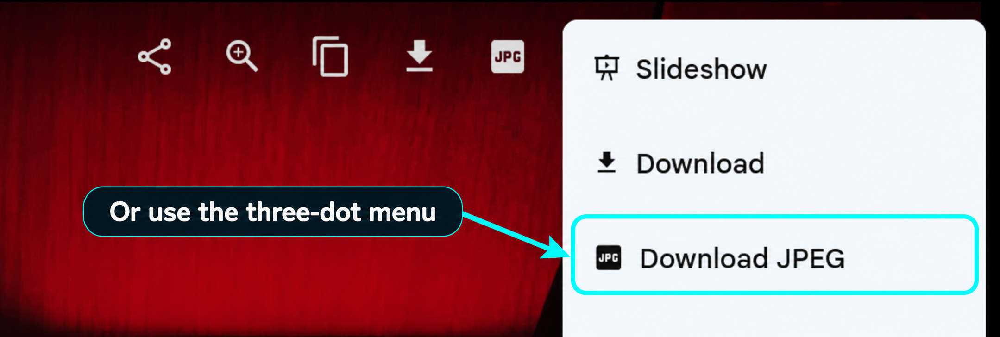

# Make Immich JPEGs Great Again

Download the **full-size JPEG embedded in your RAW** directly from Immich. Uses ExifTool (`-JpgFromRaw2` for RW2, `-JpgFromRaw` for other RAWs): no conversion, resizing or re-encoding.

For the 24 MP Panasonic RW2 files shown here:

| File | Resolution |
| --- | --- |
| RAW | **24 MP** |
| Embedded JPG | **24 MP** |
| Old preview | **~3 MP** |

Embedded JPEG resolution varies by camera.

## Use

Open a RAW photo and click the **JPG icon beside Download**:



Or choose **⋮ → Download JPEG**:



Both actions appear only on RAW photos. Works in desktop and mobile browsers; native Immich apps are unsupported.

## Install

### Docker

```sh
git clone https://github.com/wispdevon/MakeImmichJPEGsGreatAgain.git
cd MakeImmichJPEGsGreatAgain
cp .env.example .env
```

1. Edit `.env`: set your `PUBLIC_ORIGIN`, `IMMICH_URL` and `IMMICH_NETWORK`. For automatic button injection, set `WEB_UPSTREAM_URL` to your existing internal Immich web/gateway URL.
2. Run `docker compose up -d --build`.
3. Add the routes from [the Caddy example](deploy/Caddyfile.example) to your existing Immich domain, keeping your TLS settings. Reload the proxy, then refresh Immich.

### Without Docker

Install **Python 3.12 or 3.13** (with venv support) and **ExifTool** (`sudo apt install libimage-exiftool-perl` on Debian/Ubuntu). From the cloned repository:

```sh
python3.12 -m venv .venv
.venv/bin/python -m pip install -r requirements.txt
PUBLIC_ORIGIN=https://photos.example.com \
IMMICH_URL=http://127.0.0.1:2283 \
WEB_UPSTREAM_URL=http://127.0.0.1:2283 \
.venv/bin/uvicorn server.app:app --host 127.0.0.1 --port 8100 --no-access-log
```

Replace the URLs with your browser origin and reachable Immich server/web addresses. Use the same [proxy routes](deploy/Caddyfile.example) as above, targeting `127.0.0.1:8100`. Check `http://127.0.0.1:8100/raw-jpeg/health`. This command runs in the foreground and does not load `.env` automatically.

[Full installation guide, Immichinko integration and userscript alternative →](docs/INSTALL.md)

MIT · Independent Immich add-on.
